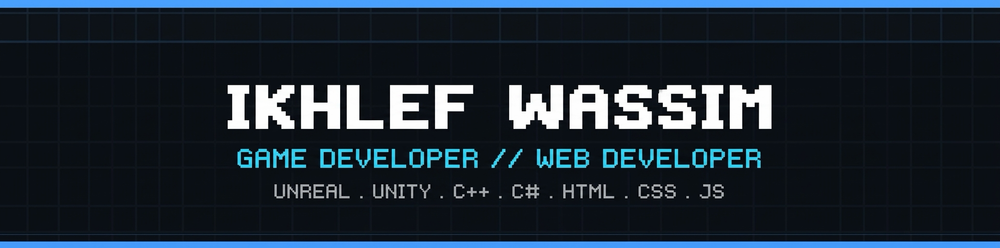
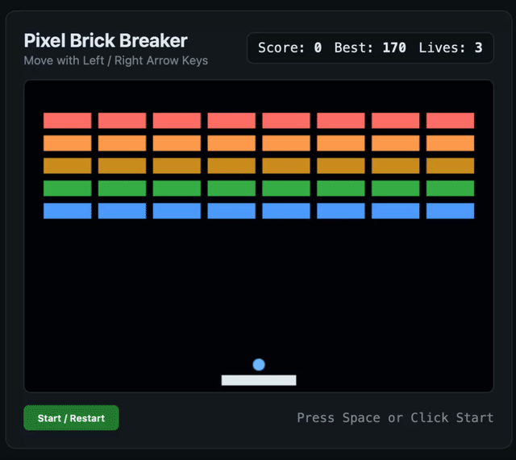

<picture>
    <source media="(prefers-color-scheme: dark)" srcset="./assets/banner-v3.png" />
    
  </picture>

  <picture>
    <source media="(prefers-color-scheme: dark)" srcset="https://readme-typing-svg.demolab.com?font=Fira+Code&weight=600&size=20&duration=3000&pause=1000&color=58A6FF&center=true&vCenter=true&width=600&height=40&lines=Game+Developer+%26+Web+Developer;Building+Worlds+in+Unreal%2C+Unity+%26+C%2B%2B;Crafting+Interactive+Web+Experiences" />
    
  </picture>

# Hi there, I'm Ikhlef Wassim 🎮💻

**Game Developer & Web Developer • Building Worlds & Web Experiences**

📍 Algeria |  Discord: `ikh._.wa` | 🐙 GitHub: [@ikhlef-wassim](https://github.com/Ikhlef-wassim) | 🌐 [Portfolio](https://ikhlef-wassim.github.io) |  | 

---

### Tech Stack

| Game Development | Web Development | Workflow & Tools |
| :---: | :---: | :---: |
|     |    |     |

### What I Do

- 🎮 **Game Development:** Building gameplay mechanics, interactive worlds, and systems in **Unreal Engine** and **Unity** using **C++** and **C#**
- 🌐 **Web Development:** Creating responsive interfaces and interactive web experiences with **HTML**, **CSS**, and **JavaScript**
- 🤝 **Open to Collaborate:** Looking for game jams, indie projects, and freelance web work. Reach me on Discord: `ikh._.wa`

### Playing & Inspirations

- 🎮 **Playing:** ARK, Subnautica
- ✨ **Inspired by:** Minecraft, Hogwarts Legacy

---

  <picture>
    <source media="(prefers-color-scheme: dark)" srcset="https://streak-stats.demolab.com?user=Ikhlef-wassim&hide_border=false&background=0D1117&border=30363D&stroke=30363D&ring=58A6FF&fire=58A6FF&currStreakLabel=58A6FF&sideLabels=E6EDF3&currStreakNum=E6EDF3&sideNums=E6EDF3&dates=8B949E" />
    
  </picture>

  <picture>
    <source media="(prefers-color-scheme: dark)" srcset="https://raw.githubusercontent.com/Ikhlef-wassim/Ikhlef-wassim/output/github-contribution-grid-snake-dark.svg" />
    
  </picture>

### Featured Projects

| Project | Description | Links |
| :--- | :--- | :--- |
| **Pixel Brick Breaker** | Interactive 60 FPS HTML5 Canvas arcade game with arrow-key paddle physics, wave progression, and persistent high scores.  | [Live Demo](https://ikhlef-wassim.github.io/pixel-arcade-web/) &bull; [Source Code](https://github.com/Ikhlef-wassim/pixel-arcade-web) |
| **Unreal C++ Sandbox** | Unreal Engine 5 C++ gameplay systems repository featuring Blueprint-exposed `UActorComponent` classes and Git LFS asset tracking. | [Source Code](https://github.com/Ikhlef-wassim/unreal-cpp-sandbox) |
| **Unity Arcade Prototype** | Unity C# gameplay prototype featuring responsive movement, cooldown dash mechanics, and Git LFS asset configuration. | [Source Code](https://github.com/Ikhlef-wassim/unity-arcade-prototype) |
| **C++ Terminal Arcade** | 2D ASCII rogue dungeon crawler game engine written in pure C++ with custom non-canonical keyboard parsing and bounds physics. | [Source Code](https://github.com/Ikhlef-wassim/cpp-terminal-arcade) |
| **Sorting Algorithms Visualizer** | Real-time dark-mode sorting visualizer (Bubble, Selection, Insertion, Quick Sort) with live comparison/swap counters. | [Live Demo](https://ikhlef-wassim.github.io/algo-visualizer-web/) &bull; [Source Code](https://github.com/Ikhlef-wassim/algo-visualizer-web) |

---
