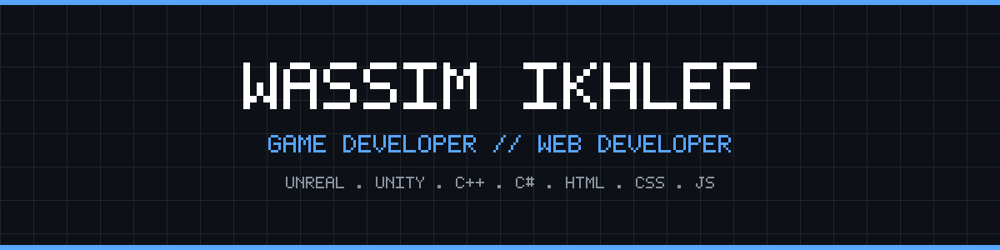

# Hi there, I'm Wassim Ikhlef 🎮💻

**Game Developer & Web Developer • Building Worlds & Web Experiences**

📍 Algeria &nbsp;|&nbsp; 💬 Discord: `ikh._.wa` &nbsp;|&nbsp; 🐙 GitHub: [@Ikhlef-wassim](https://://github.com)

---

### Tech Stack

| Game Development | Web Development | Workflow & Tools |
| :---: | :---: | :---: |
|     |    |     |

### What I Do

- 🎮 **Game Development:** Building gameplay mechanics, interactive worlds, and systems in **Unreal Engine** and **Unity** using **C++** and **C#**
- 🌐 **Web Development:** Creating responsive interfaces and interactive web experiences with **HTML**, **CSS**, and **JavaScript**
- 🛠️ **Version Control & CLI:** Managing projects with clean Git history, SSH/CLI workflows (`gh`), and structured Markdown documentation
